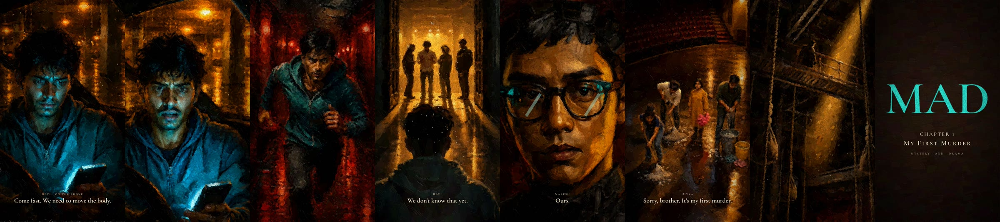

# painted-cinema

**Turn a story into a short painterly film with Claude.** One painting per shot, repainted every frame as moving oil brush strokes, with camera moves, paint-over "acting", light and dust, subtitles and a soundtrack.



*Frames from [`examples/mad-teaser`](examples/mad-teaser): a 40-second vertical teaser for the mystery novel* MAD.

## How it works

1. **You give Claude a story.** It could be a chapter, a script, a product idea or a poem.
2. **Claude directs.** It writes a shot list with framing, camera moves and dialogue.
3. **Claude gets the paintings** from whatever image generator you have connected (Canva, Codex CLI, any image API), or from your own art. Each shot gets one image. Key moments get a *variant* (the same image, but the character looks up, a barrier rises, a light comes on).
4. **The player paints the film.** Each image becomes thousands of brush strokes, built coarse to fine, that follow the image's own edges and are lit like real paint ridges. The camera pushes, pulls or pans inside the painting. Variants are re-laid stroke by stroke, so the painting appears to act. Shots paint over each other, and a low raking light makes the paint ridges flare.
5. **`film.json` describes everything**: shots, images, camera, effects, subtitles, title, audio. `scripts/render.mjs` turns it into an MP4 and an SRT file.

## Install (Claude Code)

```sh
git clone https://github.com/ChandraSKN/painted-cinema
cd painted-cinema && npm install && npx playwright install chromium
```

Then add it as a plugin. Or copy `skills/painted-cinema/` into `~/.claude/skills/` and keep the repo next to it. Then ask Claude:

> Make a 40-second painted teaser of chapter 1 of my novel (attached), vertical, with subtitles.

You need Node 18+ and ffmpeg, and an image generator for new paintings (or your own images).

## Use it without Claude

```sh
node scripts/render.mjs examples/mad-teaser --still 1.2,9.5,24   # preview frames → out/still_*.jpg (render cache in out/frames)
node scripts/render.mjs examples/mad-teaser                     # full film → out/film.mp4 + film.srt
```

Add `--software` on machines without a usable GPU (WebGL in software: slower, but works anywhere). An interrupted render picks up where it stopped. The schema is in [`skills/painted-cinema/reference/film-json.md`](skills/painted-cinema/reference/film-json.md).

## Repository

```
skills/painted-cinema/    the Claude skill: SKILL.md + reference (film.json schema, image prompting, directing)
runtime/engine/           the paint engine: flow-field stroke builder + WebGL brush/lighting renderer
runtime/player.js         the film.json player: shots, camera, paint-over, effects, subtitles, title
scripts/render.mjs        headless renderer → MP4 / SRT / preview stills
examples/mad-teaser/      a complete example film
```

## Credits

- Thanks to **[Lemo-Opuscar](https://github.com/lemomo-ai/lemo-opuscar)** by Lemomo (LemoLab), whose painted-film styles inspired this project. painted-cinema's engine, player, renderer and skill are written from scratch.
- Fonts and other third-party material: [`THIRD_PARTY_NOTICES.md`](THIRD_PARTY_NOTICES.md).
- The example film's paintings are AI-generated (Canva). Its credits are in [`examples/mad-teaser/CREDITS`](examples/mad-teaser/CREDITS).

## License

MIT, see [`LICENSE`](LICENSE). You are responsible for the rights to the images, voices and music you put into your films.
